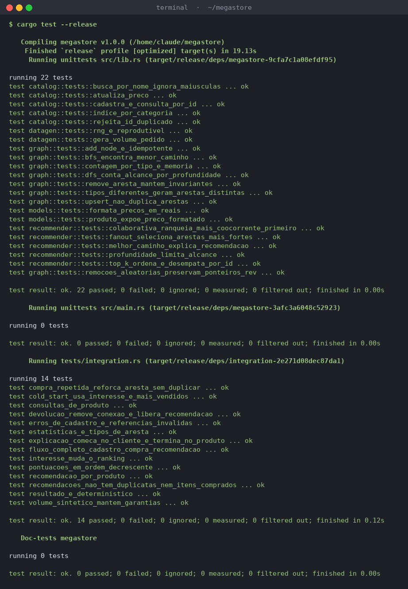
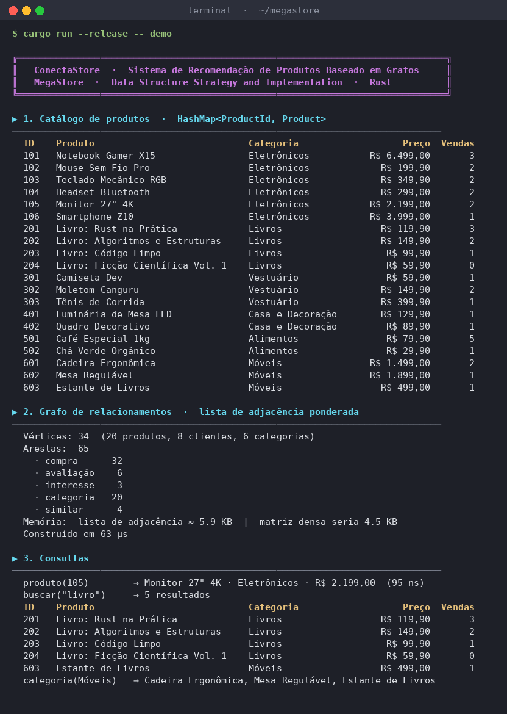
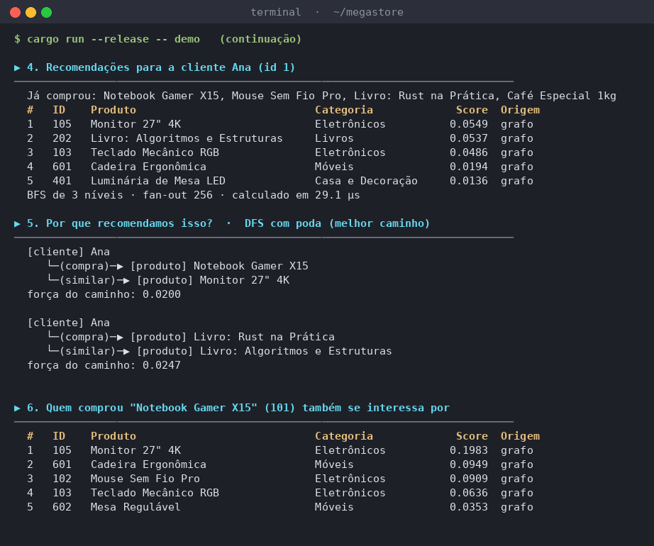
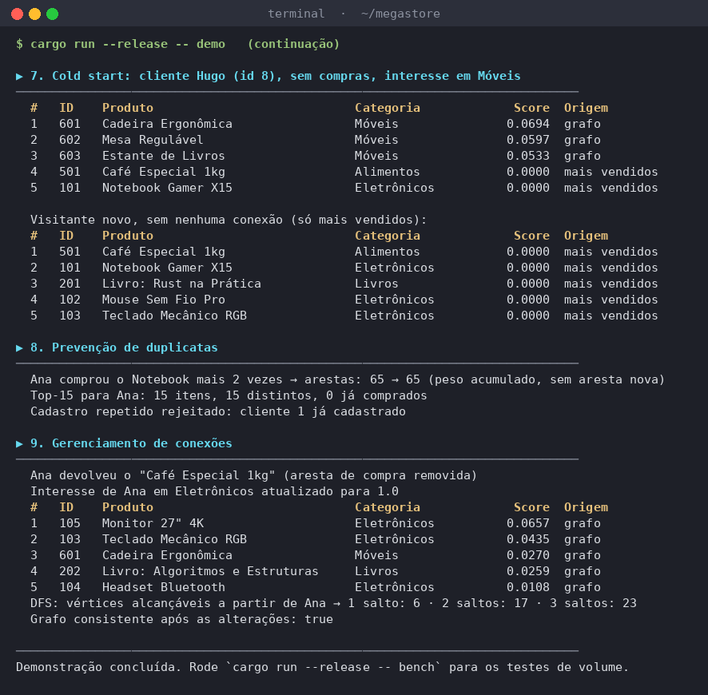
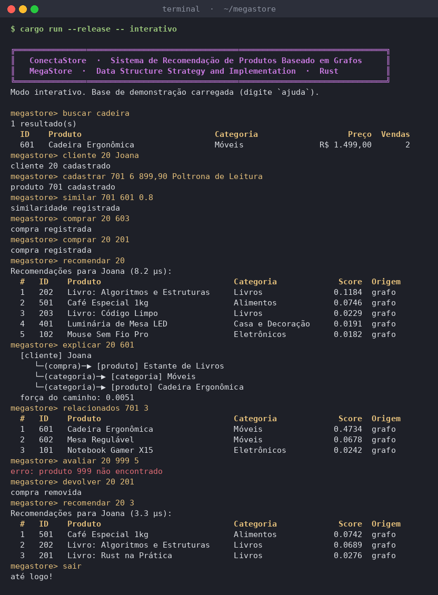
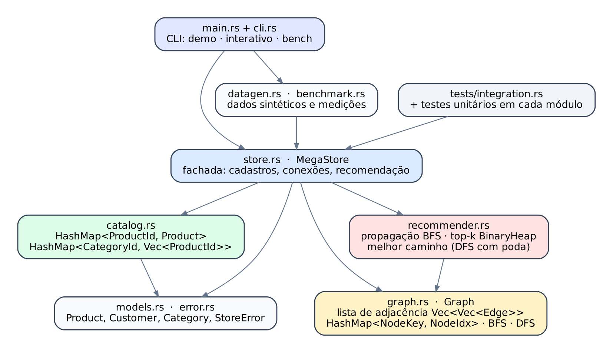
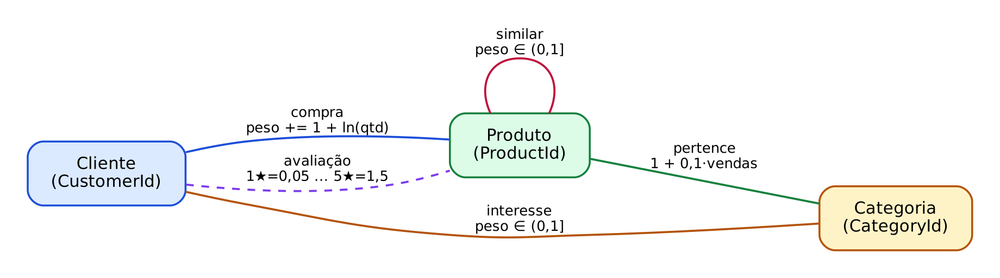
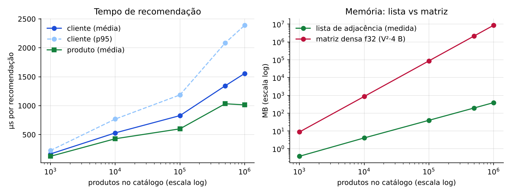
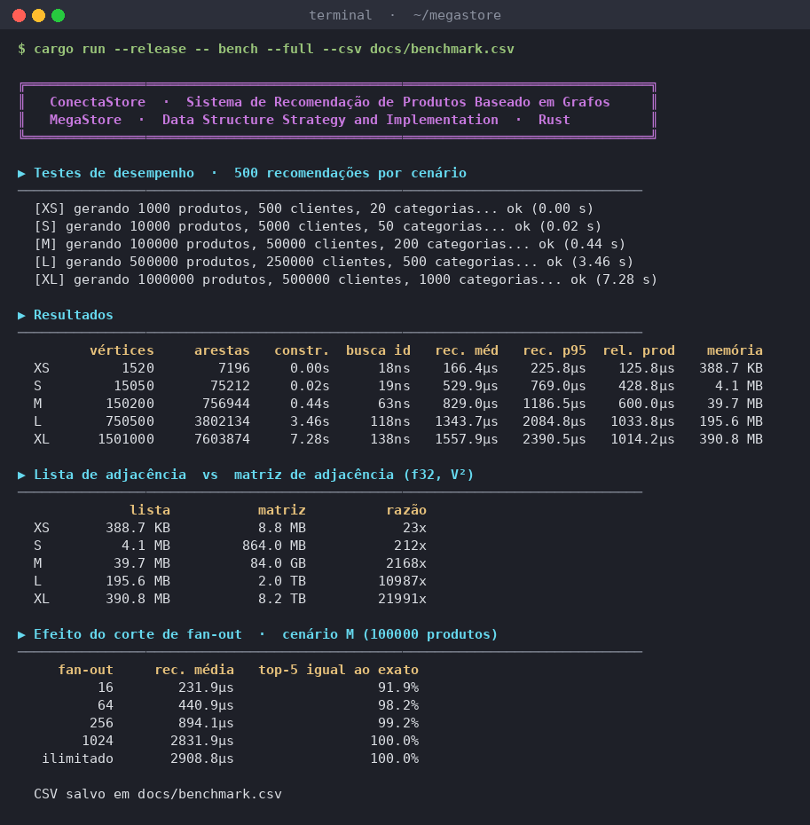

# ConectaStore: Sistema de Recomendação de Produtos Baseado em Grafos

Projeto da disciplina **Data Structure Strategy and Implementation** (UniFECAF).
Sistema de recomendação da MegaStore escrito em **Rust**, sem dependências externas.

> 🔗 **Repositório:** https://github.com/Kayke-ns/megastore
>
> 📄 **Relatório técnico:** [`docs/Relatorio_Tecnico_ConectaStore.pdf`](docs/Relatorio_Tecnico_ConectaStore.pdf)

---

## 1. Objetivo e funcionamento

O catálogo da MegaStore cresceu e as recomendações atuais (mais vendidos e "mesma categoria")
ignoram as relações entre clientes, compras, avaliações e categorias. O ConectaStore modela
essas relações como um **grafo** e percorre as conexões de cada cliente para encontrar
produtos relevantes:

- **"Quem comprou o que você comprou também comprou..."**: cliente → produto → outro cliente → produto
- **"Do seu interesse"**: cliente → categoria de interesse → produto
- **"Parecido com o que você comprou"**: cliente → produto → produto similar

Cada caminho contribui com uma pontuação proporcional aos pesos das arestas. O sistema devolve
os *k* produtos de maior pontuação, **nunca repete um item** e **nunca recomenda o que o cliente
já comprou**. Também explica cada recomendação mostrando o caminho que mais contribuiu.

## 2. Tecnologias e estruturas utilizadas

| Estrutura | Onde | Por quê |
|---|---|---|
| `HashMap<ProductId, Product>` | `catalog.rs` | cadastro e consulta por ID em O(1) médio |
| `HashMap<CategoryId, Vec<ProductId>>` | `catalog.rs` | lista uma categoria sem varrer o catálogo |
| `Vec<Vec<Edge>>` (lista de adjacência) | `graph.rs` | memória O(V+E); percorrer vizinhos custa O(grau) |
| `HashMap<NodeKey, NodeIdx>` | `graph.rs` | traduz ID de negócio em índice denso do vetor |
| ponteiro `rev` em cada aresta | `graph.rs` | atualiza/remove aresta nas duas pontas sem índice extra |
| `VecDeque` | `graph.rs` | fila da BFS de menor caminho |
| `HashSet<NodeIdx>` | `recommender.rs` | visitados da BFS e itens excluídos |
| `HashMap<NodeIdx, f64>` | `recommender.rs` | pontuação acumulada: uma entrada por produto (sem duplicatas) |
| `BinaryHeap` (min-heap de tamanho k) | `recommender.rs`, `store.rs` | top-k em O(n log k) |
| pilha `Vec` | `graph.rs`, `recommender.rs` | DFS iterativa e DFS com poda |

Rust 2021, apenas biblioteca padrão. Testado com `rustc 1.97`.

## 3. Compilação e execução

Pré-requisito: [Rust](https://rustup.rs) instalado (`cargo --version`).

```bash
git clone https://github.com/Kayke-ns/megastore.git
cd megastore
cargo build --release

cargo run --release                 # demonstração completa
cargo run --release -- interativo   # modo interativo
cargo run --release -- bench        # testes de desempenho (1 mil a 500 mil produtos)
cargo run --release -- bench --full --csv docs/benchmark.csv   # inclui 1 milhão de produtos
cargo run --release -- ajuda
```

## 4. Execução dos testes

```bash
cargo test            # 22 testes unitários + 14 de integração
cargo test --release  # mesmos testes com otimização
cargo clippy --all-targets   # análise estática (0 avisos)
```

Os testes unitários ficam dentro de cada módulo (`#[cfg(test)]`); os de integração em
`tests/integration.rs` usam somente a API pública. Eles cobrem cadastro e erros, consultas,
ausência de duplicatas, exclusão de itens comprados, ordenação das pontuações, *cold start*,
remoção de conexões, consistência interna do grafo após centenas de inserções/remoções
aleatórias, determinismo e um volume sintético de 20 mil produtos.



## 5. Exemplos de uso

### Demonstração





### Modo interativo

```text
megastore> cliente 20 Joana
megastore> cadastrar 701 6 899,90 Poltrona de Leitura
megastore> similar 701 601 0.8
megastore> comprar 20 603
megastore> recomendar 20
megastore> explicar 20 601
megastore> relacionados 701 3
megastore> devolver 20 201
```

Comandos: `produtos`, `produto`, `buscar`, `cadastrar`, `cliente`, `comprar`, `avaliar`,
`interesse`, `similar`, `devolver`, `recomendar`, `relacionados`, `explicar`, `stats`, `sair`.



### Como biblioteca

```rust
use megastore::{MegaStore, Product, RecommendConfig};

let mut loja = MegaStore::new();
loja.add_category(1, "Eletrônicos")?;
loja.add_product(Product::new(10, "Notebook", 1, 500_000))?;
loja.add_product(Product::new(11, "Mouse", 1, 10_000))?;
loja.add_customer(1, "Ana")?;
loja.add_customer(2, "Bia")?;
loja.record_purchase(1, 10, 1)?;
loja.record_purchase(2, 10, 1)?;
loja.record_purchase(2, 11, 1)?;

let recs = loja.recommend_for_customer(1, &RecommendConfig::default())?;
assert_eq!(recs[0].product_id, 11);
```

## 6. Arquitetura da solução

```
megastore/
├── src/
│   ├── main.rs          ponto de entrada da CLI
│   ├── cli.rs           demo, modo interativo e saída do benchmark
│   ├── lib.rs           exporta os módulos da biblioteca
│   ├── models.rs        Product, Customer, Category
│   ├── error.rs         StoreError (erros tipados)
│   ├── catalog.rs       catálogo com HashMap e índice por categoria
│   ├── graph.rs         grafo em lista de adjacência, BFS e DFS
│   ├── recommender.rs   propagação ponderada, top-k, melhor caminho
│   ├── store.rs         MegaStore: fachada que integra tudo
│   ├── demo.rs          base de demonstração
│   ├── datagen.rs       gerador de dados sintéticos (determinístico)
│   └── benchmark.rs     medições de desempenho
├── tests/integration.rs
├── docs/                relatório, prints, figuras, resultados do benchmark
├── Cargo.toml
└── README.md
```



**Modelo do grafo** (não direcionado, ponderado, heterogêneo):



**Algoritmo:** BFS por níveis, até 3 saltos, com propagação de relevância. A massa de cada
vértice é dividida entre os vizinhos na proporção `peso / soma_dos_pesos_do_vértice`,
multiplicada por um fator do tipo de aresta (compra 1,0 · avaliação 1,0 · similar 0,9 ·
interesse 0,7 · categoria 0,35) e por um decaimento de 0,85 a cada nível. Vértices com grau
muito alto só propagam pelas 256 arestas mais fortes (*fan-out*), o que mantém o custo de
cada consulta praticamente estável mesmo com milhões de vértices.

## 7. Resultados dos testes de desempenho

Máquina de referência: contêiner Linux, 2 vCPUs, 7 GB de RAM, `--release`.
500 recomendações aleatórias por cenário; média de 8 compras por cliente.

| Cenário | Produtos | Clientes | Vértices | Arestas | Construção | Busca por ID | Rec. cliente (média / p95) | Rec. produto | Memória do grafo | Matriz equivalente |
|---|---:|---:|---:|---:|---:|---:|---:|---:|---:|---:|
| XS | 1.000 | 500 | 1.520 | 7.196 | 1,5 ms | 18 ns | 166 µs / 226 µs | 126 µs | 0,4 MB | 8,8 MB |
| S | 10.000 | 5.000 | 15.050 | 75.212 | 22 ms | 19 ns | 530 µs / 769 µs | 429 µs | 4,1 MB | 864 MB |
| M | 100.000 | 50.000 | 150.200 | 756.944 | 0,44 s | 63 ns | 829 µs / 1,19 ms | 600 µs | 39,7 MB | 84 GB |
| L | 500.000 | 250.000 | 750.500 | 3.802.134 | 3,5 s | 118 ns | 1,34 ms / 2,08 ms | 1,03 ms | 196 MB | 2,0 TB |
| XL | 1.000.000 | 500.000 | 1.501.000 | 7.603.874 | 7,3 s | 138 ns | 1,56 ms / 2,39 ms | 1,01 ms | 391 MB | 8,2 TB |

- O catálogo cresceu **1000×** e o tempo de recomendação cresceu cerca de **9×**.
- A construção cresce de forma linear (≈ 7 µs por produto com seus relacionamentos).
- A matriz de adjacência seria inviável a partir de 100 mil produtos.

Efeito do corte de *fan-out* (cenário M):

| `max_fanout` | 16 | 64 | **256 (padrão)** | 1024 | ilimitado |
|---|---:|---:|---:|---:|---:|
| tempo médio | 232 µs | 441 µs | **894 µs** | 2.832 µs | 2.909 µs |
| top-5 igual ao exato | 91,9% | 98,2% | **99,2%** | 100% | 100% |




Os números variam com o hardware; rode `cargo run --release -- bench --full` para reproduzir.

## 8. Limitações e próximos passos

- Busca por nome é linear; em produção usaria um índice invertido.
- O grafo vive em memória; para dezenas de milhões de clientes, particionar por região ou
  categoria, ou usar um banco de grafos.
- Pesos e fatores foram definidos manualmente; poderiam ser calibrados com testes A/B.
- Recomendações podem ser pré-calculadas em lote para os clientes mais ativos.
